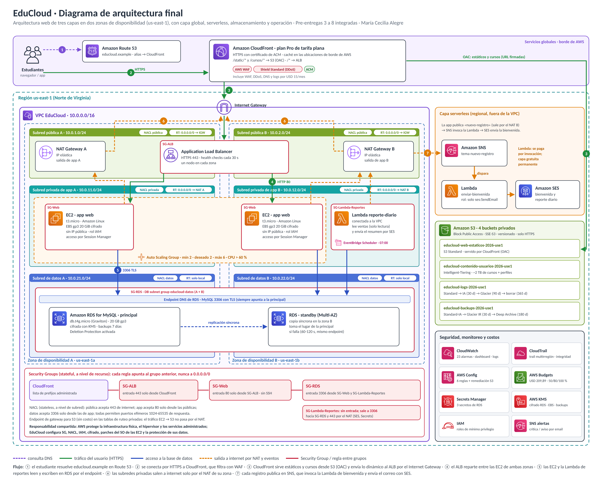

# EduCloud · Arquitectura en AWS (Proyecto Final)

Diseño completo de una plataforma educativa en AWS: aplicación web de tres capas en dos zonas de disponibilidad, entrega de contenido por CloudFront, almacenamiento en S3 con ciclos de vida, procesos serverless, monitoreo con CloudWatch y control de costos con AWS Budgets.

Es el proyecto final del curso **AWS Cloud Practitioner de Coderhouse** (aprobado en noviembre de 2026). Reúne las pre-entregas del curso en un único **Documento de Diseño de Solución Cloud (DDSC)**, escrito como la propuesta técnica de una consultora para su cliente.

📄 **[Leer el DDSC completo (PDF, 17 páginas)](docs/01_DDSC_Proyecto_Final_EduCloud.pdf)**



## Resumen

| | |
|---|---|
| **Región** | us-east-1 (Norte de Virginia), 2 zonas de disponibilidad |
| **Costo estimado** | **USD 209,89 por mes** · USD 2.518,68 en 12 meses · sin costo inicial |
| **Disponibilidad** | Todas las capas redundantes: ALB, Auto Scaling (mín. 2 / máx. 6), un NAT por zona y RDS Multi-AZ |
| **Monitoreo** | 23 alarmas de CloudWatch, dashboard de operaciones, CloudTrail y AWS Config (6 reglas) |
| **Well-Architected** | Validado en los 6 pilares, incluida Sostenibilidad |

## Arquitectura

| Capa | Servicios | Decisión clave |
|---|---|---|
| Borde | Route 53, CloudFront (plan Pro de tarifa plana), AWS WAF, Shield Standard, ACM | USD 15 fijos por mes con WAF, DNS y 50 TB de transferencia incluidos |
| Red | VPC 10.0.0.0/16, 6 subredes /24 (pública, app y datos en cada AZ), Internet Gateway, 2 NAT Gateways, endpoint de gateway para S3 | Las subredes privadas salen a internet solo por el NAT de su zona; la de datos no tiene ruta a internet |
| Cómputo | Application Load Balancer, EC2 t3.micro en Auto Scaling, EBS gp3 | Escala horizontalmente cuando la CPU supera el 60 % |
| Datos | RDS for MySQL db.t4g.micro Multi-AZ, Secrets Manager, KMS | Failover automático al standby sin cambiar el endpoint |
| Almacenamiento | 4 buckets S3: estáticos, contenido (~2 TB de cursos en Intelligent-Tiering), logs y backups con ciclos de vida | Los videos se sirven por CloudFront con URL firmadas |
| Serverless | SNS → Lambda → SES (bienvenida) · EventBridge Scheduler → Lambda (reporte diario) | Dentro de la capa gratuita permanente de Lambda |
| Operación | CloudWatch, CloudTrail, AWS Config, AWS Budgets, IAM con mínimo privilegio, Session Manager (sin SSH) | Alertas de presupuesto al 50 %, 80 % y 100 % previsto |

**Cadena de Security Groups:** CloudFront (lista de prefijos administrada) → SG-ALB (443) → SG-Web (80) → SG-RDS (3306) ← SG-Lambda-Reportes. Ninguna regla de entrada usa 0.0.0.0/0 detrás de CloudFront.

## Costos

La estimación se hizo en AWS Pricing Calculator ([enlace público](https://calculator.aws/#/estimate?id=3c5e9cf448c7c1cbc8f0c7a11de4a9e8ad9566c4), válido hasta noviembre de 2027; el detalle completo también está en el DDSC y en [costos/capturas](costos/capturas)).

| Servicio | USD/mes |
|---|---:|
| Amazon VPC (2 NAT Gateways, 4 IPv4 públicas, transferencia de datos) | 86,10 |
| Amazon S3 (contenido, logs, backups y estáticos) | 30,22 |
| Amazon RDS for MySQL Multi-AZ | 27,96 |
| Amazon EC2 + EBS | 18,38 |
| Elastic Load Balancing (ALB) | 18,01 |
| Amazon CloudFront (plan Pro) | 15,00 |
| CloudWatch, AWS Config, CloudTrail | 12,42 |
| Secrets Manager, SES, Lambda, SNS | 1,80 |
| **Total** | **209,89** |

Casi la mitad del costo (USD 104,11) es red y balanceador: NAT Gateways, IPv4 públicas y transferencia. Son los costos que se pierden cuando se estima solo EC2 y RDS.

## Contenido del repositorio

```
docs/
  01_DDSC_Proyecto_Final_EduCloud.pdf          Documento de diseño completo (entrega final)
  02_Mapa_Responsabilidad_Compartida.pdf       Modelo de responsabilidad compartida
  03_Estrategia_Almacenamiento.pdf             Buckets, clases de S3, ciclos de vida, EBS y snapshots
  04_Arquitectura_Datos.pdf                    RDS Multi-AZ, subredes de datos y accesos
  05_Presupuesto_Pricing_Calculator_Budgets.pdf
diagramas/                                     Arquitectura final y diagramas por capa
infraestructura/
  cloudformation/
    rds-educloud.yaml                          RDS MySQL Multi-AZ, SG-RDS, secretos y subredes de datos
    monitoreo-alarmas.yaml                     Temas SNS, 23 alarmas, filtro de logs y dashboard
    cloudtrail-trail.yaml                      Trail multirregión con validación de integridad
    auditoria-config.yaml                      AWS Config (6 reglas, remediación) y reglas de EventBridge
  iam/                                         Políticas de mínimo privilegio para EC2 y Lambda
  s3-lifecycle/                                Reglas de ciclo de vida de los 4 buckets
  budgets/crear_presupuesto_educloud.sh        Presupuesto de USD 209,89 con 3 alertas (AWS CLI)
sql/                                           Esquema, usuarios con mínimo privilegio y consultas
monitoreo/
  matriz-alarmas.csv                           Las 23 alarmas: métrica, umbral, severidad y motivo
  dashboard-educloud-operaciones.json          Dashboard de CloudWatch
costos/capturas/                               Pricing Calculator y alertas de AWS Budgets
```

## Cómo usar las plantillas

Las plantillas pasan `cfn-lint` sin errores. Todas se despliegan en **us-east-1** y los valores propios de cada cuenta (ID de la cuenta, IDs del ALB, NAT y CloudFront, correo de alertas) van como parámetros: el repositorio no contiene datos de ninguna cuenta real.

```bash
# Validar una plantilla
aws cloudformation validate-template --template-body file://infraestructura/cloudformation/monitoreo-alarmas.yaml

# Probar el presupuesto sin crear nada (solo muestra el JSON)
DRY_RUN=1 bash infraestructura/budgets/crear_presupuesto_educloud.sh
```

> ⚠️ Desplegar esta arquitectura genera costos reales (unos USD 210 por mes). Es un proyecto de diseño: si lo desplegás para practicar, borrá los recursos al terminar.

## Pre-entregas que integra

| Entrega | Tema |
|---|---|
| Pre-entrega 1 | Modelo de responsabilidad compartida |
| Pre-entrega 3 | Cómputo: ALB, EC2 en Auto Scaling, SNS → Lambda → SES |
| Pre-entrega 4 | Estrategia de almacenamiento en S3 y EBS |
| Pre-entrega 5 | Base de datos: RDS MySQL Multi-AZ |
| Pre-entrega 6 | Red: VPC, subredes, NAT, NACL, CloudFront y WAF |
| Pre-entrega 7 | Monitoreo y auditoría |
| Pre-entrega 8 | Presupuesto con Pricing Calculator y AWS Budgets |

## Autora

**María Cecilia Alegre** · Curso AWS Cloud Practitioner, Coderhouse (2026)
